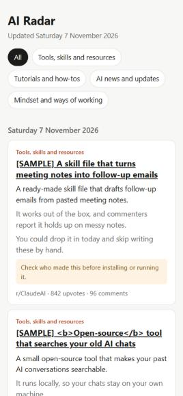

# AI Radar

**Your own daily digest of the Reddit posts actually worth your time.**

Every morning it fetches the top posts from the subreddits you choose, has Claude pick the ones useful to *you*, explains each in a few lines, and sends you the digest. It also keeps a dashboard you can open on your phone. It runs online, so your computer can be off.



It was built for keeping up with AI, but it works for any interest. See the [woodworking example](examples/hobby-weekly.yaml).

## Get your own

**You need:** about 30 minutes and an email address. No coding. **Cost:** about $4 a month, or less on a cheaper AI model (see [Costs](#costs)).

| | Step | What you do | Done when |
|---|---|---|---|
| 1 | **[Copy this template](https://github.com/yousuf-farid/ai-radar/generate)** | Name it and choose Public | You have your own `ai-radar` repository |
| 2 | **[Create 3 accounts](SETUP.md#2-create-your-accounts)** | Apify, Anthropic, Resend | You have a key from each |
| 3 | **[Add your keys](SETUP.md#3-add-your-keys-to-github)** | Paste them into GitHub Secrets | 4 secrets are listed |
| 4 | **[Turn on the dashboard](SETUP.md#4-turn-on-the-dashboard)** | Change one setting | Source says "GitHub Actions" |
| 5 | **[Fill in your preferences](SETUP.md#5-fill-in-your-preferences)** | Edit `config.yaml` | No `FILL IN` left |
| 6 | **[Test and switch on](SETUP.md#6-test-the-scraper)** | Click a few buttons | A digest lands in your inbox |

**➡️ [Start the full step-by-step guide](SETUP.md)**

Already running? **[CUSTOMISE.md](CUSTOMISE.md)** explains every setting and how to improve your picks.

> **Status:** the code is tested with simulated services, and its setup path on GitHub has been checked. It hasn't yet run a live digest against the real scraper, AI and email. Early users may hit a small fix or two, so please [report anything odd](https://github.com/yousuf-farid/ai-radar/issues).

## Costs

These are estimates for 5 subreddits and 10 posts each, daily.

| Service | What it does | Per month |
|---|---|---|
| Apify | Fetches the posts | About $3.60, normally covered by its free $5 credit |
| Anthropic | Picks and summarises | About $4 on the best model, about $0.10 on the cheapest |
| Resend | Sends the email | Free |
| GitHub | Runs the job and hosts the dashboard | Free for a public repository |

You pay each service directly, from your own accounts. Apify's free plan stops rather than charging you if the credit runs out, and Anthropic is prepaid, so there's no surprise bill.

## What it does when things go wrong

- **Bad data:** if the scraper returns nothing, or every post has 0 upvotes, it stops rather than sending a bad digest.
- **Failures:** you get one alert a day, saying what went wrong. It tries at most 3 times a day, so a broken scraper can't drain your credit.
- **Retries:** each step saves its result, so a retry doesn't pay twice or send a second email.
- **Hostile posts:** the AI treats posts as untrusted text and has no tools. Links come from the scraper rather than the AI, and anything asking you to install or run something gets a warning.

## Good to know

- **Your repository is public,** so anyone who finds it can see your `config.yaml`, profile and picks. Your keys and email address stay private in GitHub Secrets. Write your profile accordingly.
- **This uses a third-party scraper,** because Reddit is [closing its public API](https://www.techrepublic.com/article/news-reddit-rss-public-api-shutdown/) and doesn't welcome scraping. Any scraper could break at short notice, and it's designed so one can be swapped easily. [OPTIONS.md](OPTIONS.md) compares the alternatives.

## For developers

```
config.yaml ──► 1. Collect ──► 2. Filter + summarise ──► 3. Dashboard
 (settings)       Apify           Claude               ──► 4. Email / Slack
```

GitHub starts the job hourly, and `run.py` only acts once per period, after the chosen local time. That handles clock changes and late starts.

| File | Job |
|---|---|
| `config.yaml` | One person's settings |
| `run.py` | Runs the steps in order |
| `radar/collect.py` | Fetches posts. The only file that knows about scrapers |
| `radar/curate.py` | The AI step. Edit `SYSTEM` to change how it chooses |
| `radar/render.py` | Dashboard and email design |
| `radar/deliver.py` | Sends email or Slack |
| `data/` | Saved results, updated by the job |

Try it locally with made-up posts and no keys:

```bash
pip install -r requirements.txt pytest
```

```bash
python run.py --demo
```

```bash
python -m pytest
```
